# Workflow Diagrams

How each part of the `.claude/` workflow works. The diagrams are in Mermaid, which renders on GitHub, in VS Code (with a Mermaid extension) and in most Markdown viewers.

| # | Diagram | Shows |
|---|---|---|
| 1 | [Component map](#1-component-map) | Every file and how the pieces depend on each other |
| 2 | [Coordinator lifecycle](#2-coordinator-lifecycle-dev) | The phases of `/dev`, from triage to report |
| 3 | [A feature run, end to end](#3-a-feature-run-end-to-end) | Who talks to whom, in order |
| 4 | [Request routing](#4-request-routing) | How a prompt turns into a route and a size |
| 5 | [Context isolation](#5-context-isolation-and-token-flow) | Why the main thread stays small |
| 6 | [Agents](#6-agents) | What each worker reads, does, writes and returns |
| 7 | [Guard hooks](#7-guard-hooks) | How tool calls are allowed or denied |
| 8 | [Quality gate](#8-quality-gate-verifysh) | `verify.sh` step by step |
| 9 | [plan.md lifecycle](#9-planmd-lifecycle) | The single state file and its statuses |
| 10 | [Stage skills](#10-stage-skills) | `/dev-test`, `/dev-review`, `/dev-ship`, `/dev-onboard` |

---

## 1. Component map

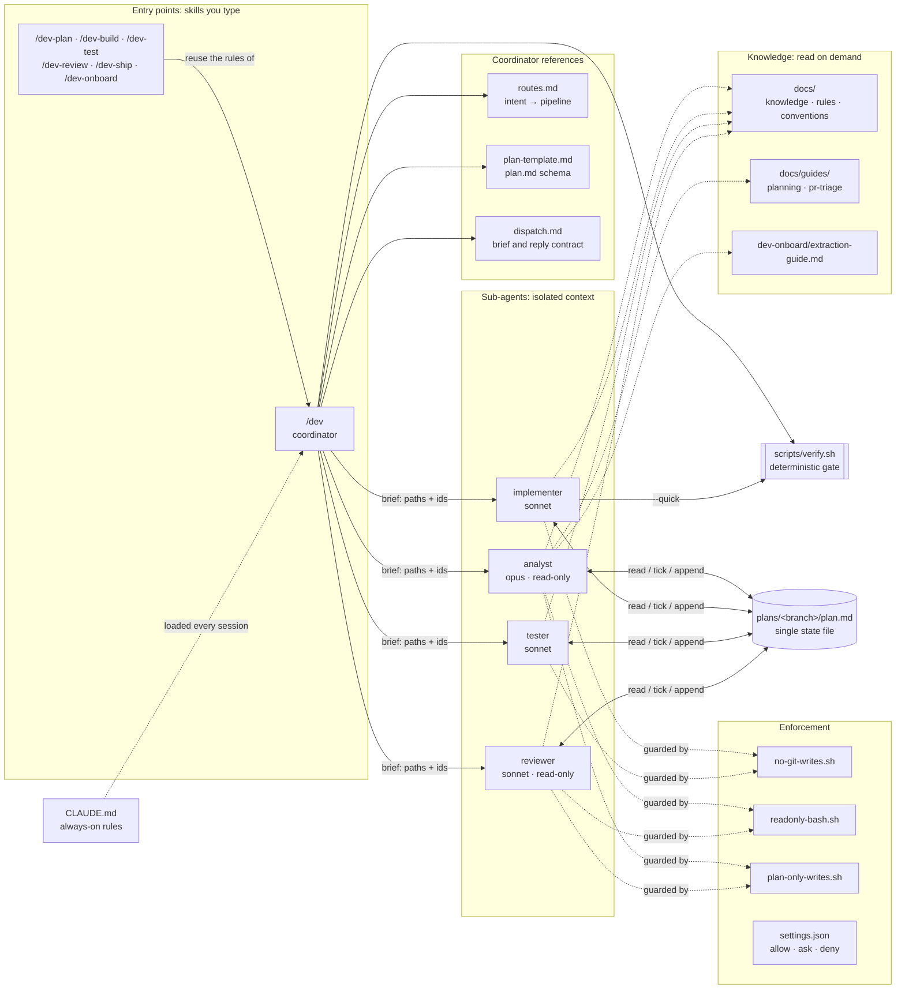

**Reading guide**

| Folder | Purpose | Loaded when |
|---|---|---|
| `skills/` | What runs when you type a command. `dev/` is the coordinator. The other skills each run one stage and follow the coordinator's rules. | When you invoke it (`disable-model-invocation: true`) |
| `agents/` | Workers, each with its own context window, tool list, model and hooks | When the coordinator dispatches it |
| `hooks/` | Bash + `jq` guards, wired into agent frontmatter | On every tool call that agent makes |
| `scripts/verify.sh` | The only definition of "done" | After every wave, and by implementers (`--quick`) |
| `docs/`, `docs/guides/` | Project knowledge and long checklists | Only by the agent and mode that needs them |
| `plans/` (gitignored) | One `plan.md` per branch | Throughout a run; this is how resume works |

---

## 2. Coordinator lifecycle (`/dev`)

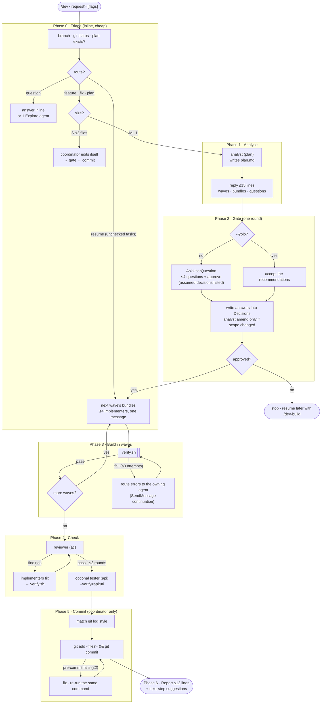

---

## 3. A feature run, end to end

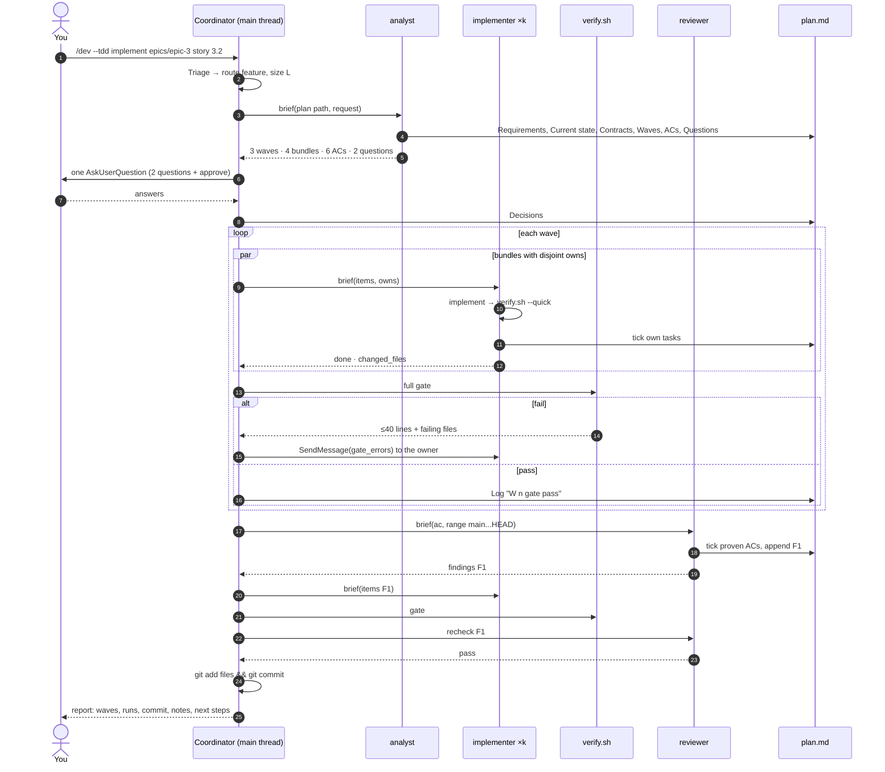

---

## 4. Request routing

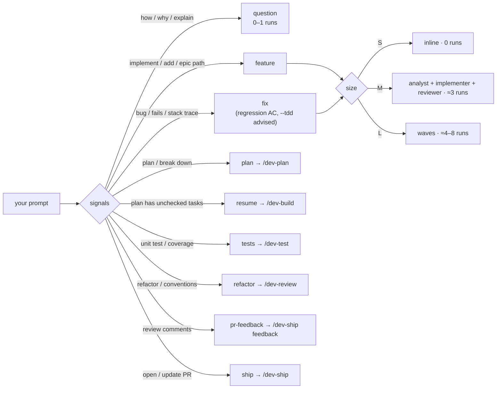

---

## 5. Context isolation and token flow

Each sub-agent works in **its own context window**. Only small, structured replies come back into the long-lived main thread.

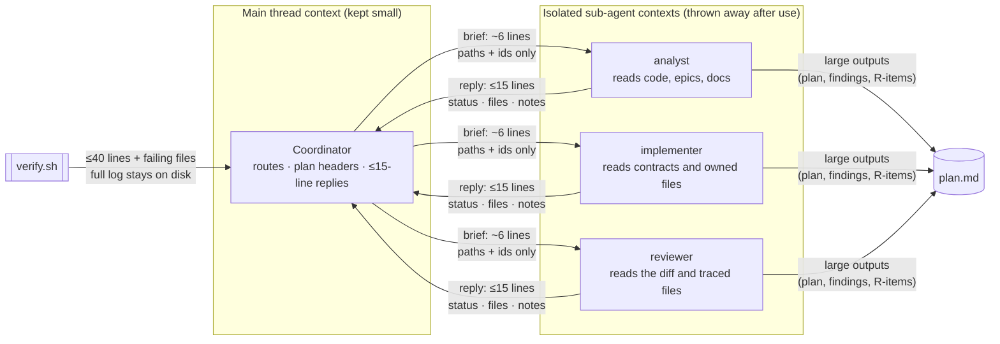

| Mechanism | Effect |
|---|---|
| The coordinator never reads source | Exploration never fills the main thread |
| Briefs carry paths and ids, not content | Prompts stay tiny, and every agent reads the same `plan.md` |
| Replies of ≤15 lines; detail goes to `plan.md` | The main thread grows by a few lines per agent |
| Size S runs inline | No agent overhead for small edits |
| Bundles group related tasks | The number of runs scales with modules, not with task count |
| `SendMessage` continuation for fixes | The fixer already has its context loaded |
| Guides are read per mode | Each agent loads only the instructions it needs |

---

## 6. Agents

### 6.1 analyst (opus · read-only · writes only under `.claude/plans/`)

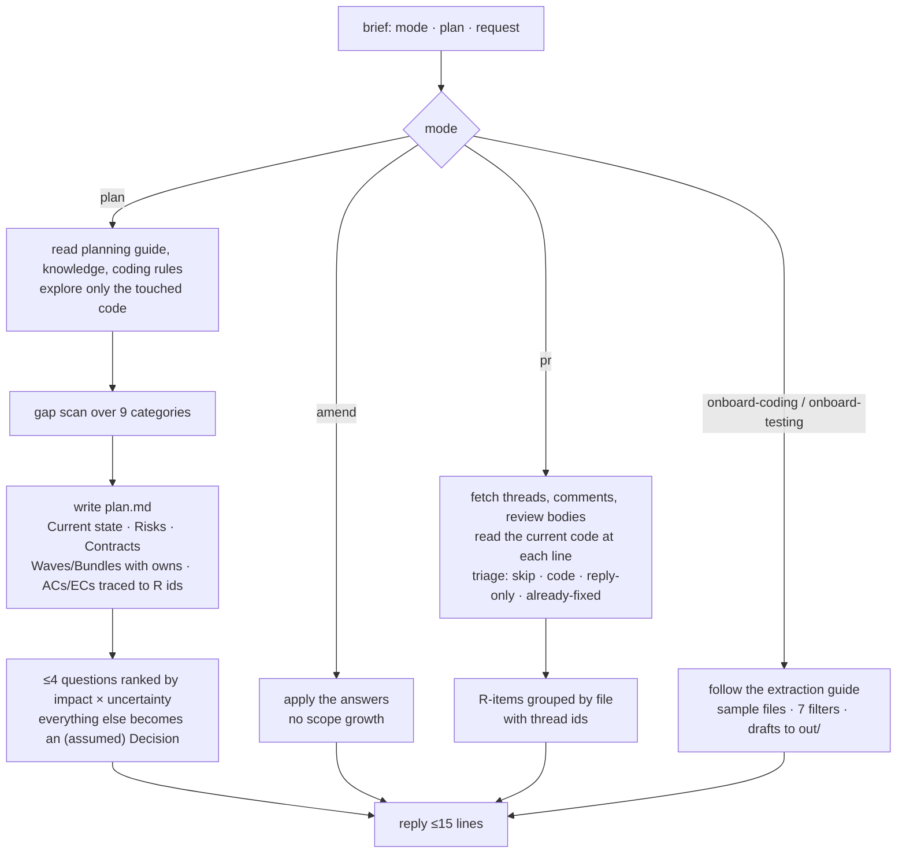

### 6.2 implementer (sonnet · edits code · cannot commit)

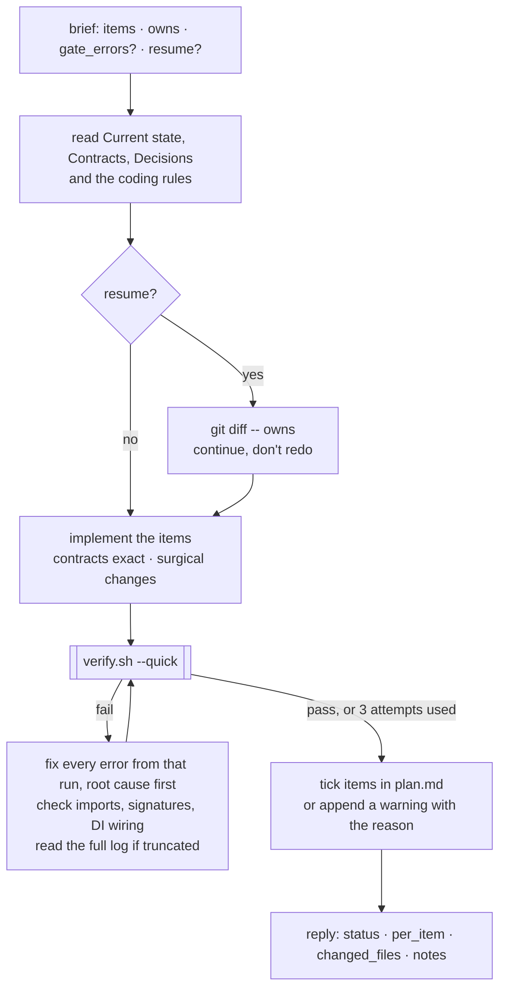

### 6.3 tester (sonnet · edits tests only · cannot commit)

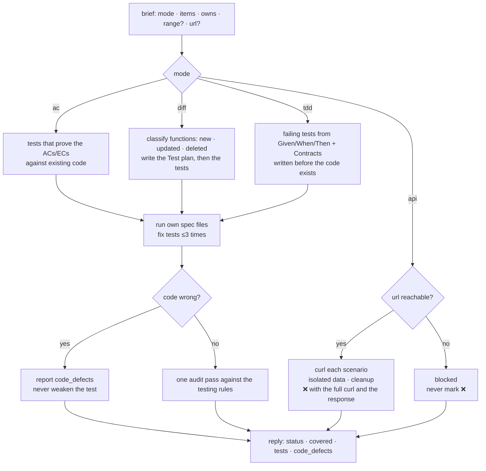

### 6.4 reviewer (sonnet · read-only · writes only `plan.md`)

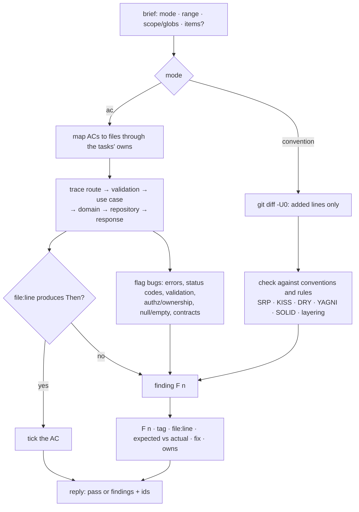

---

## 7. Guard hooks

The hooks are wired through each agent's frontmatter, so they apply only to that agent. A denial comes back to the agent as a reason it can act on.

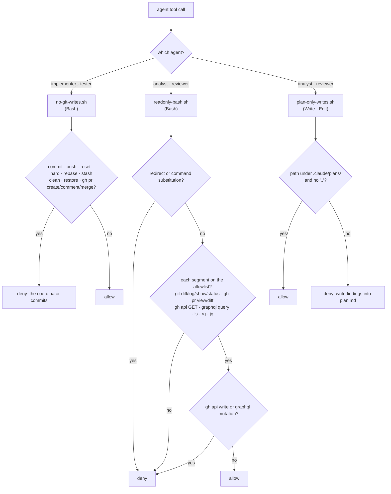

**Project-wide permissions** (`settings.json`) cover everything else, including the coordinator:
- **allow:** the gate script, package scripts, read-only git and `gh` commands, `.claude/plans/**` edits
- **ask:** `git push`, `gh pr create`, `gh pr comment`, `gh pr merge`, writes through `gh api`
- **deny:** `--no-verify`, force-push

---

## 8. Quality gate (`verify.sh`)

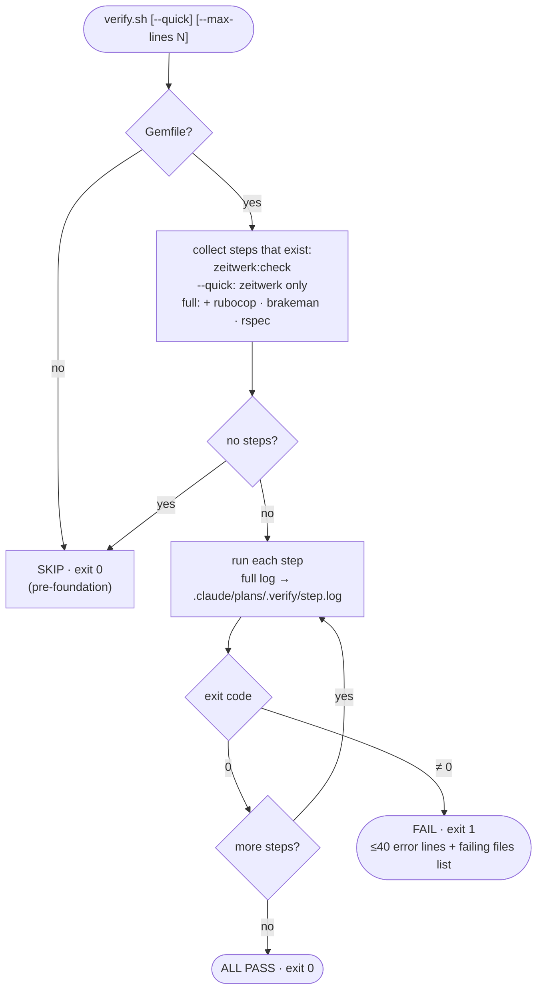

The exit code is the single source of truth. No agent decides that a change is done.

---

## 9. plan.md lifecycle

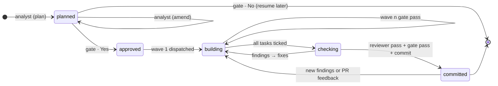

| Section | Written by | Read by |
|---|---|---|
| Meta, Log | coordinator | coordinator (triage, resume) |
| Requirements, Current state, Risks, Approach, Contracts | analyst | implementer, tester, reviewer |
| Decisions, Open questions | analyst; coordinator writes the answers | everyone |
| Tasks (waves, bundles, owns) | analyst; implementers tick them | coordinator (dispatch) |
| Acceptance criteria | analyst; reviewer and tester tick them | tester, reviewer |
| Test plan | tester | tester (resume) |
| Findings | reviewer; implementers tick them | coordinator, implementer |
| PR feedback | analyst (pr) | coordinator, implementer, `/dev-ship update` |

---

## 10. Stage skills

### 10.1 `/dev-test` and `/dev-review`

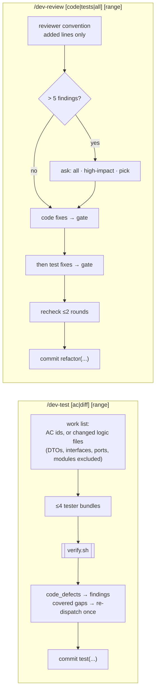

### 10.2 `/dev-ship`

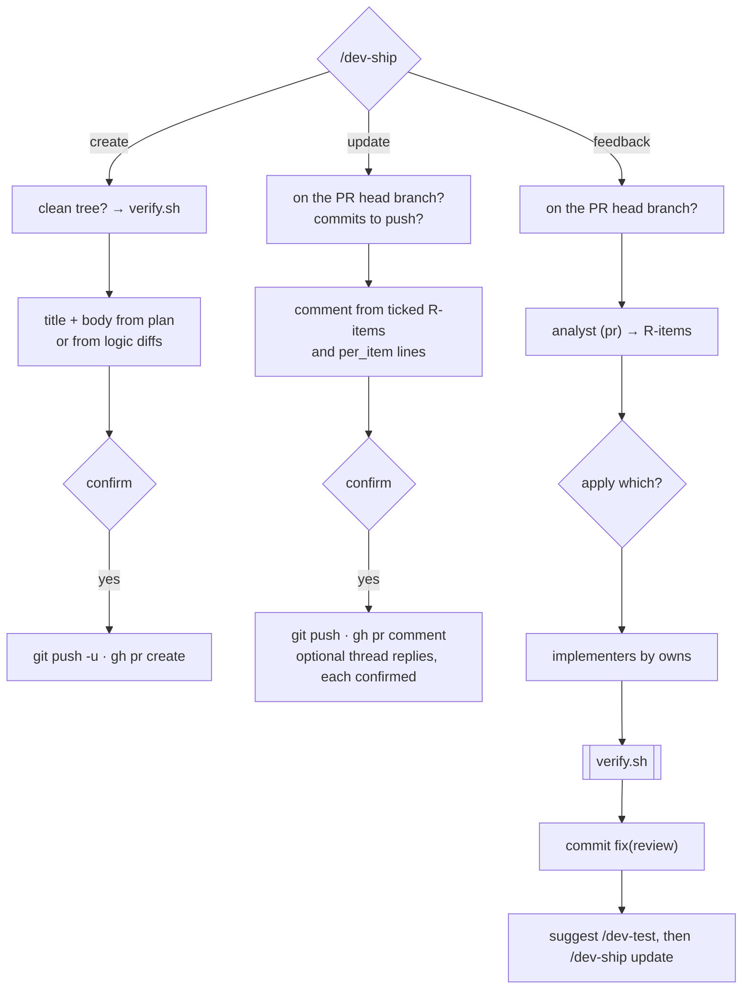

### 10.3 `/dev-onboard`

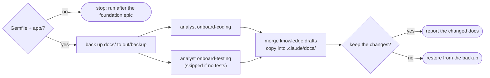
