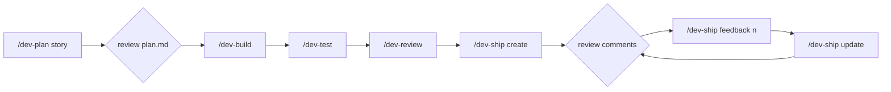

# Instructions: Using the Coordinator Workflow

The operating manual for `.claude/`: setup, daily use, customisation, reuse and troubleshooting. For what the workflow is and why, see [README.md](README.md). For how each part works, see [DIAGRAMS.md](DIAGRAMS.md).

---

## 1. Prerequisites

| Tool | Needed for | Check |
|---|---|---|
| Claude Code (CLI, VS Code or desktop) | Everything | `claude --version` |
| `git` | Everything | `git --version` |
| `bash`, `jq`, `perl` | Guard hooks and the gate | `jq --version && perl -v \| head -2` |
| Ruby 3.4 (rbenv), Bundler, PostgreSQL 16 | The gate, once the project has a `Gemfile` | `ruby -v && bundle -v && pg_isready` |
| GitHub CLI `gh`, authenticated | `/dev-ship` only | `gh auth status` |

macOS ships with `jq`, `perl` and `bash`. Install `gh` with `brew install gh`, then run `gh auth login`.

---

## 2. What's in the folder

```text
CLAUDE.md                         always-on rules + map of the knowledge docs (repo root)
.claude/
├── README.md · Instruction.md · DIAGRAMS.md
├── settings.json                 project permissions: allow / ask / deny
├── skills/
│   ├── dev/                      /dev: the coordinator
│   │   ├── SKILL.md              phases, limits, flags
│   │   └── reference/            routes.md · plan-template.md · dispatch.md
│   ├── dev-plan/ dev-build/ dev-test/ dev-review/
│   ├── dev-ship/                 + pr-template.md
│   └── dev-onboard/              + extraction-guide.md
├── agents/                       analyst.md · implementer.md · tester.md · reviewer.md
├── hooks/                        _lib.sh · no-git-writes.sh · readonly-bash.sh · plan-only-writes.sh
├── scripts/verify.sh             the gate
├── docs/                         knowledge.md · coding-rules.md · coding-convention.md
│   │                             testing-rules.md · testing-convention.md
│   └── guides/                   planning.md · pr-triage.md
└── plans/                        per-branch plan.md files (gitignored, created on first run)
```

---

## 3. One-time setup

1. **Make the scripts executable.** Git usually keeps the mode, but check:
   ```bash
   chmod +x .claude/hooks/*.sh .claude/scripts/verify.sh
   ```
2. **Check the gitignore.** `.gitignore` must contain `.claude/plans/` and `.claude/settings.local.json`.
3. **Check the gate works:**
   ```bash
   .claude/scripts/verify.sh
   ```
   With no `Gemfile` yet, it prints `verify: SKIP - no Gemfile yet` and exits 0. That's expected.
4. **Start a new Claude Code session.** Skills, agents and settings load at session start.
5. **Check discovery:**
   - Run `/agents`. It should list `analyst`, `implementer`, `tester` and `reviewer` under project agents.
   - Type `/dev`. Autocomplete should show `dev`, `dev-plan`, `dev-build`, `dev-test`, `dev-review`, `dev-ship` and `dev-onboard`.
6. **Smoke test with no code changes:**
   ```text
   /dev question: what does epic 2 require?
   ```
   It should answer inline, or with one Explore agent, and should not create a plan or a commit.

---

## 4. First run

Start small. One story is enough to see every phase.

```bash
git switch -c feat/foundation-skeleton
```

```text
/dev --tdd implement the project skeleton from epics/epic-1-backend-project-foundation.md (story 1.1 only)
```

What you should see:

| Step | What happens | What to check |
|---|---|---|
| Triage | The coordinator states the route and size | `feature`, size M or L |
| Analyse | The `analyst` runs and reports waves, bundles and questions | `.claude/plans/feat-foundation-skeleton/plan.md` exists |
| Gate | **One** question dialog: up to 4 questions plus "Approve plan?" | Recommended options come first; the approval text lists the assumed decisions |
| Wave 0 | The `tester` writes failing tests (because of `--tdd`) | The tests compile against the Contracts |
| Waves 1..n | Implementers run in parallel, then `verify.sh` | `## Log` gets `W<n> ✅ gate pass` lines |
| Check | The `reviewer` ticks ACs or writes `F<n>` findings | ACs are ticked only with a cited `file:line` |
| Commit | The coordinator commits | One commit, in the existing message style or Conventional Commits |
| Report | 12 lines or fewer | Sub-agent runs, gate attempts, notes, next steps |

The quick gate is `bin/rails zeitwerk:check`, which exists as soon as the foundation epic generates the app. Then run `/dev-onboard` (see §5) to replace the seed docs with rules taken from the real code.

---

## 5. Daily use

### Typical cycle



Or run `/dev <request>`, which covers plan → build → check → commit in one go.

### Commands and examples

| Command | Example | Notes |
|---|---|---|
| `/dev` | `/dev add PATCH /tasks/:id/assignee per epic-3 story 3.4` | Routes automatically |
| | `/dev fix: creating a task with an empty title returns 500` | Route `fix`; adds a regression AC |
| | `/dev why does the project module import TaskModule?` | Route `question`; no changes |
| `/dev-plan` | `/dev-plan epics/epic-4-subtask-management.md` | Stops after approval. Re-run it to refine the plan. |
| `/dev-build` | `/dev-build --verify=api:http://localhost:3000` | Resumes from the first unchecked task |
| `/dev-test` | `/dev-test diff` · `/dev-test ac` · `/dev-test diff a1b2c3d` | `diff` covers changed **logic** files only |
| `/dev-review` | `/dev-review code` · `/dev-review all main...HEAD` | Reviews **added lines only** |
| `/dev-ship` | `/dev-ship create` · `/dev-ship feedback 12` · `/dev-ship update` | Asks you before any push or comment |
| `/dev-onboard` | `/dev-onboard` · `/dev-onboard testing` | Backs up the docs, then asks you to keep or restore |

### Flags (`/dev`, `/dev-build`, `/dev-plan`)

| Flag | Effect |
|---|---|
| `--yolo` | Accept every recommended answer and skip the approval gate. Push and PR actions still ask. |
| `--fresh` | Archive the branch plan to `plan.<timestamp>.md` and start over |
| `--tdd` | Wave 0: failing tests from the ACs before any implementation |
| `--verify=api:<url>` | After the gate passes, the tester checks every AC with curl against a running server |

Add any other instruction in plain words; the coordinator passes it only to the agents it concerns. For example: `/dev-build only wave 1, don't touch migrations`.

---

## 6. Working with `plan.md`

The plan is plain Markdown at `.claude/plans/<branch-with-dashes>/plan.md`. You can read and edit it by hand.

| You want to | Do this |
|---|---|
| Review before building | `/dev-plan …`, read `plan.md`, answer No at the gate, edit, then `/dev-build` |
| Change a contract or task | Edit `## Contracts` or `## Tasks` directly, keeping the `- [ ] T<n> … - bundle: B<n> - owns: …` format, then `/dev-build` |
| Skip a task | Tick it by hand: `- [x]` |
| Re-run a finished task | Untick it, then `/dev-build` |
| Resume after a crash or Ctrl-C | `/dev-build`. Bundles whose files are already modified get `resume: true` and continue from `git diff`. |
| Start over | `/dev <request> --fresh` |
| See what happened | `## Log`: gate passes, attempts, commit hashes, `per_item` lines |

**Sections at a glance:**
- Meta
- Requirements (with `[NEEDS CLARIFICATION → Qn]` markers)
- Current state, Risks, Approach
- Decisions (`(assumed)` lines are ones you weren't asked about)
- Open questions
- Contracts
- Tasks by wave and bundle
- Acceptance criteria (`AC<n> (R<n>)` and `EC<n> (R<n>)`)
- Test plan, Findings, PR feedback
- Log

---

## 7. Answering the gate

- Each question shows the **recommended** option first, and each option has a description of what it means for the feature.
- To override an `(assumed)` decision listed in the approval question, pick **Other** and type it, for example `pagination default 50`.
- Choosing **No, stop here** saves everything. Run `/dev-build` when you're ready.
- `--yolo` skips the gate entirely. Use it only for small, well-understood work.

---

## 8. Customise

| What | Where | Default |
|---|---|---|
| Parallelism, fix attempts, review rounds, base branch | `skills/dev/SKILL.md` › Settings | 4 · 3 · 2 · `main` |
| Model per agent | `model:` in each `agents/*.md` frontmatter | analyst `opus`, others `sonnet` |
| Gate steps | `scripts/verify.sh` (zeitwerk, lint, security, test) | Whatever exists: `bin/rails`, RuboCop gem, `bin/brakeman`, `rspec-rails` |
| Gate output size | `verify.sh --max-lines N` | 40 |
| Permissions | `settings.json` (shared) or `settings.local.json` (yours only, gitignored) | See the file |
| Coding and testing rules | `docs/*.md`, regenerated by `/dev-onboard` | Seeded from Epic 0 (`epics/epic-1-backend-project-foundation.md`) |
| Planning checklists | `docs/guides/planning.md` | Gap scan, ≤4 questions, EC categories |
| PR description | `skills/dev-ship/pr-template.md` | Summary · Details · ACs · Checklist · Notes |
| Always-on rules | `CLAUDE.md` (repo root) | No comments, no debug code, validation, pure functions |

**Rules for edits:**
- Keep agent prompts short. Put long checklists in a guide and point the agent to it from its mode section.
- If you change a field in the R-item or finding format, change it everywhere it appears: `plan-template.md`, `guides/pr-triage.md`, `agents/reviewer.md` and `skills/dev-ship/SKILL.md`.
- Start a new session after any change to skills, agents or settings.

---

## 9. Reuse in another project

The orchestration core is project-agnostic: the coordinator phases, routing, `plan.md`, the dispatch contract, the hooks and the agent roles. These parts are tuned to the Scheduler Rails API and need adapting:

| File | Scheduler-specific part | Change it to |
|---|---|---|
| `CLAUDE.md` | Rails scheduler description and rules | The new project's summary and always-on rules |
| `docs/*.md` | Rails, Active Record, RSpec content | Empty stubs, then run `/dev-onboard` once code exists |
| `docs/guides/planning.md` | Mentions `task-flow.swagger.json` and the epics | The new project's contract and requirement sources |
| `scripts/verify.sh` | Rails only (`Gemfile`, zeitwerk, RuboCop, Brakeman, RSpec) | Add detection for the stack: `package.json` → typecheck/build/lint/test scripts · `pyproject.toml` → ruff/mypy/pytest · `go.mod` → `go vet`/`go test` · `*.csproj` → `dotnet build`/`dotnet test` · `pom.xml`/`build.gradle` → mvn/gradle · `Cargo.toml` → `cargo clippy`/`cargo test` |
| `skills/dev-test/SKILL.md`, `skills/dev-review/SKILL.md` | `app/**/*.rb`, `lib/**/*.rb` and `spec/**/*.rb` globs | The new project's source, test and declarative-only paths |
| `agents/tester.md` | `bundle exec rspec <files>` | The project's single-file test command |
| `agents/implementer.md` | Zeitwerk naming and `app/domain` layering hint | The framework's wiring checks, or remove the hint |
| `settings.json` | rspec, rubocop, zeitwerk and brakeman allow rules | The project's build and test commands |
| `skills/dev/reference/plan-template.md` | `TaskEntity` and route examples | Neutral or project examples |
| `skills/dev/SKILL.md` | `base_branch: main` | The project's default branch |

**Steps:**
1. Copy `.claude/` (without `plans/`) and `CLAUDE.md` into the new repo, and add `.claude/plans/` to its `.gitignore`.
2. Work through the table above.
3. Run §3 (setup) and §4 (first run) in the new repo.

---

## 10. Troubleshooting

| Symptom | Likely cause | Fix |
|---|---|---|
| `/agents` doesn't list the four agents | The session started before the files existed, or the frontmatter is broken | Start a new session; check each file starts with a valid `---` YAML block |
| An agent says "Blocked: …" | A guard hook denied a tool call, which is intended | Read the reason. If the command is legitimate for that role, adjust the hook's allowlist. |
| A hook never fires | `jq` is missing, the script isn't executable, or `$CLAUDE_PROJECT_DIR` is unset | `chmod +x .claude/hooks/*.sh`; install `jq`; test by hand (below) |
| The gate always says SKIP | No `Gemfile`, or no `bin/rails`, RuboCop, `bin/brakeman` or `rspec-rails` | Generate the app and add the gems. The gate only runs what exists. |
| The gate fails but the output is cut off | The 40-line summary | Read `.claude/plans/.verify/<step>.log` |
| The same gate error repeats 3 times, then stops | Not fixable inside that bundle's owned files | Check the report's notes. Usually a contract gap: fix it in `plan.md`, then `/dev-build`. |
| Two questions dialogs instead of one | More than 4 questions, which the analyst shouldn't produce | Re-run `/dev-plan`; check the cap in `docs/guides/planning.md` |
| `/dev-ship` fails immediately | `gh` is missing or not authenticated, or you're not on the PR's head branch | `brew install gh && gh auth login`; switch branch |
| The pre-commit hook fails twice | Lint or format issue the coordinator couldn't fix | Fix it by hand, then ask `/dev` to commit again. Never use `--no-verify`, which is blocked anyway. |

**Testing a hook by hand:**
```bash
export CLAUDE_PROJECT_DIR="$PWD"
echo '{"tool_name":"Bash","tool_input":{"command":"git commit -m x"}}' | .claude/hooks/no-git-writes.sh
echo '{"tool_name":"Write","tool_input":{"file_path":"app/models/a.rb"}}' | .claude/hooks/plan-only-writes.sh
```
JSON output with `"permissionDecision": "deny"` means the call was blocked; no output means it was allowed.

---

## 11. Guarantees

These hold whatever the prompt says:
- Sub-agents never commit, push, stash, reset or post to a PR. Only the coordinator commits.
- The analyst and reviewer never modify source or test files.
- Nothing is pushed and no PR is created or commented on without your confirmation.
- `--no-verify` and force-push are denied.
- Every fix loop is capped: 3 gate attempts, 2 review rounds, 2 pre-commit retries. When a cap is hit, the coordinator stops and reports.
- A change counts as done only when `verify.sh` exits 0.
