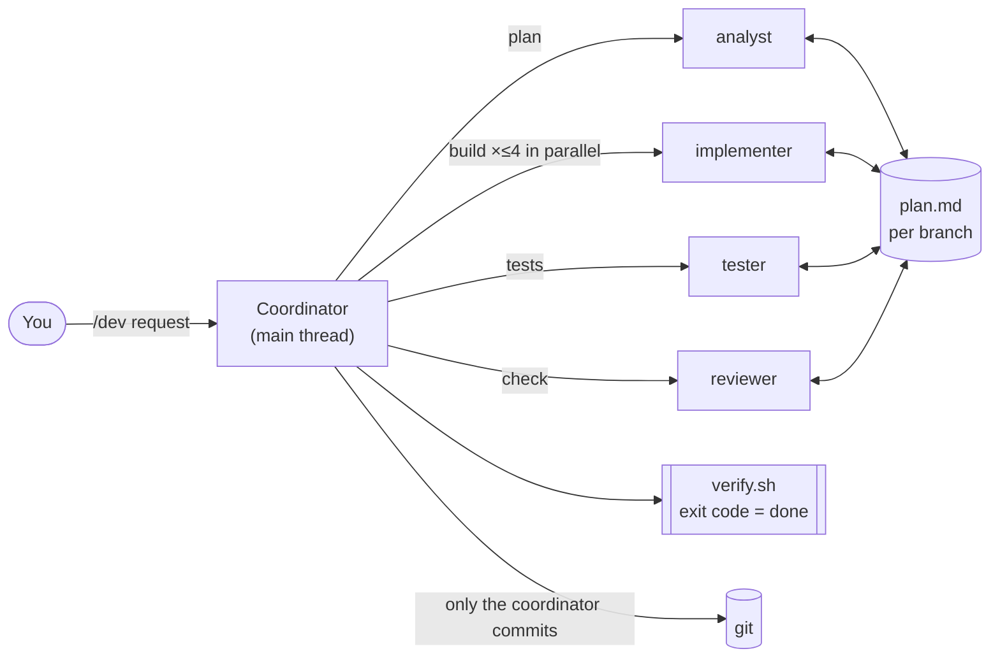

# Coordinator Workflow for Claude Code

An agentic development workflow built on Claude Code primitives. You give **one coordinator** a request in plain language. It works out what kind of request it is, plans it, asks you everything in **one** round, and sends the work to **four specialised sub-agents** in parallel waves. **A fixed script, not the model, decides when the work is done.**

```text
/dev implement epics/epic-3-task-management.md story 3.2
```



The diagram for each component is in **[DIAGRAMS.md](DIAGRAMS.md)**. Setup and day-to-day use are in **[Instruction.md](Instruction.md)**. The design rationale is in [docs/claude-coordinator-workflow.md](../docs/claude-coordinator-workflow.md).

---

## Why this workflow

| Problem with prompt-heavy agent workflows | What this workflow does |
|---|---|
| The main chat fills with file dumps and logs, and quality drops as the context grows | **Context isolation.** Exploration and coding happen in sub-agents with their own context windows. The coordinator sees briefs of about 6 lines and replies of 15 lines or fewer. |
| One agent per task leads to dozens of cold starts per feature | **Bundling and waves.** Related tasks share one run; runs scale with modules, not tasks. A typical feature takes about 4–8 runs. |
| "The model says it compiles" | **Deterministic gate.** `verify.sh` runs typecheck, build, lint and test after **every wave**. The exit code is the source of truth. |
| Rules in capital letters that nothing enforces | **Enforcement in code.** Per-agent tool lists, `PreToolUse` hooks and permission rules. A sub-agent *cannot* commit, and a reviewer *cannot* edit code. |
| Interruptions: one question here, another there | **One gate.** At most 4 ranked questions plus approval, in a single `AskUserQuestion`. Low-impact assumptions are listed rather than asked. |
| State scattered over folders and moved by a CLI | **One `plan.md` per branch.** Contracts, waves, ACs, findings and log in one readable file. Resume from the first unchecked box. |
| Integration errors found at the very end | **Early, cheap feedback.** Implementers typecheck their own work, and waves guarantee their dependencies already exist. |

---

## Modern Claude Code capabilities it uses

| Capability | How the workflow uses it |
|---|---|
| **Skills** (`.claude/skills/*/SKILL.md`) | Seven slash commands. `disable-model-invocation: true` means they run only when you type them. Reference files sit next to the skill and are loaded only when needed (progressive disclosure). |
| **Sub-agents** (`.claude/agents/*.md`) | Four roles, each with its own context window, tool allowlist, model and hooks. Several Agent calls in one message run in parallel. |
| **Model tiering** | `opus` for planning, where reasoning quality matters most. `sonnet` for implementation, testing and review, where volume matters. |
| **Agent-scoped hooks** | `PreToolUse` guards in each agent's frontmatter: no git writes for writers; read-only shell and plan-only writes for the analyst and reviewer. |
| **Permission rules** (`settings.json`) | `allow` for safe reads and the gate, `ask` for push and PR actions, `deny` for `--no-verify` and force-push. |
| **Structured human-in-the-loop** | `AskUserQuestion` with a recommended option and a `means:` description for each choice. |
| **Agent continuation** | Gate failures go back to the agent that wrote the code (`SendMessage`), which still has its context loaded. |
| **Project memory** (`CLAUDE.md`) | Always-on coding rules and a table of which doc to read when. The heavy docs are read on demand, not up front. |
| **GitHub CLI and GraphQL** | `/dev-ship` opens PRs, posts update comments, and triages review threads using their resolution state. |

---

## Architecture at a glance

| Layer | Components | Responsibility |
|---|---|---|
| **Orchestration** | `skills/dev/` (coordinator) and 6 stage skills | Route · plan · gate · dispatch · verify · commit · report |
| **Contracts** | `skills/dev/reference/` | `routes.md` (intent → pipeline), `plan-template.md` (state schema), `dispatch.md` (brief and reply formats) |
| **Workers** | `agents/analyst`, `implementer`, `tester`, `reviewer` | Plan · write code · write and run tests · verify ACs and conventions |
| **Guardrails** | `hooks/*.sh`, `settings.json` | Enforce least privilege per agent and for the project |
| **Gate** | `scripts/verify.sh` | Typecheck, build, lint and test, with compact failure output |
| **Knowledge** | `docs/`, `docs/guides/`, `skills/dev-onboard/extraction-guide.md` | Project rules and conventions, plus long checklists read per mode |
| **State** | `plans/<branch>/plan.md` (gitignored) | Shared memory between agents and the resume point |

### The agents

| Agent | Model | Can | Cannot | Returns |
|---|---|---|---|---|
| `analyst` | opus | Explore code, write `plan.md`, triage PR threads, draft knowledge docs | Edit source, run write commands | Waves, bundles, ACs, question count |
| `implementer` | sonnet | Edit owned files, run the quick typecheck | Commit, push, stash, reset, post to a PR | `per_item`, changed files, gate status |
| `tester` | sonnet | Write and run tests, curl a running API | Change production code, weaken tests to hide bugs | `covered`, test counts, `code_defects` |
| `reviewer` | sonnet | Read the diff, tick proven ACs, write findings | Edit code, run write commands | Pass, or finding ids |

### The commands

| Command | Use it to |
|---|---|
| `/dev <request>` | Do anything: feature, fix, question. It routes the request itself. |
| `/dev-plan <request>` | Plan and approve only; build later |
| `/dev-build` | Build the approved plan; resumes after interruptions |
| `/dev-test [ac\|diff]` | Add unit tests from ACs or from the changed source |
| `/dev-review [code\|tests\|all]` | Convention refactor of what the branch changed |
| `/dev-ship create\|update\|feedback` | Open a PR, post an update, or work through review comments |
| `/dev-onboard` | Regenerate the knowledge docs from the real code |

---

## How it differs from the previous Copilot workflow

| | Copilot workflow (`.github/`) | This workflow (`.claude/`) |
|---|---|---|
| Entry points | 14 skills, several of them overlapping | 1 coordinator + 6 thin stage skills |
| Workers | 20 agents | 4 agents with modes |
| State | ~8 files and 3–5 folders per branch, moved by an external CLI | 1 `plan.md` with checkboxes |
| "Done" decided by | LLM auditors, once at the end | `verify.sh` exit code after every wave |
| Verify before compile | Yes (a defect) | No: gate first, review second |
| Rule enforcement | Mostly prompt text, 1 hook | Tool lists, 3 hooks, permission rules, exit codes |
| Sub-agent runs per feature | ≈ 21 | ≈ 4–8 (estimate) |
| Self-checks | Hidden reflection checklists | None; exit codes and reviewer findings instead |
| External dependencies | An npm CLI with telemetry | bash, `jq`, `git`, and optionally `gh` |
| Prompt size | ~4,700 lines | ~740 lines in total, with agents at ~55 lines each |

The useful techniques from the old prompts were kept: gap-scan questions, AC/EC coverage rules, surgical changes, the diff test classification, and PR thread triage. [§11 of the design doc](../docs/claude-coordinator-workflow.md) maps each one to where it came from.

---

## Status and limits

- **Installed, not yet piloted.** The hooks and gate are tested on their own. The first live run should be a small story (see [Instruction.md › First run](Instruction.md#4-first-run)).
- **Tuned to this repo.** `docs/`, the diff filters in `/dev-test` and `/dev-review`, and `verify.sh` (Rails projects: `Gemfile`, zeitwerk, RuboCop, Brakeman, RSpec) assume this Rails 8 API stack. For other projects, see [Instruction.md › Reuse in another project](Instruction.md#9-reuse-in-another-project).
- **`/dev-ship` needs the GitHub CLI** (`gh`) installed and authenticated.
- UI or browser verification is not included; API checks with curl are.
