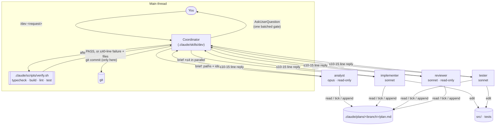
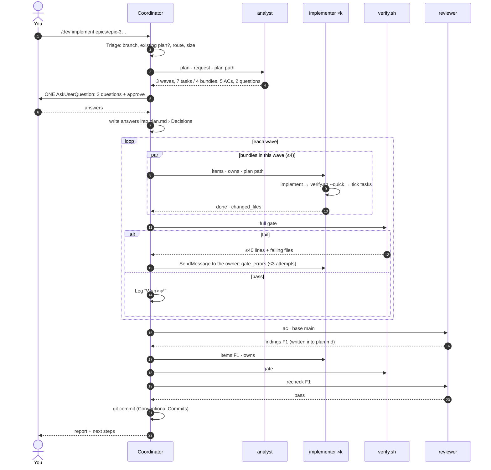

# Claude Code Coordinator Workflow

> **Scope:** a Claude Code development workflow, originally written for taskflow-be (NestJS) and retooled for the Scheduler Rails API, installed in [`.claude/`](../.claude/) and [`CLAUDE.md`](../CLAUDE.md).
> **Background:** [`ai-sdlc-workflow-analysis.md`](ai-sdlc-workflow-analysis.md) analyses the Copilot workflow in `.github/`. This doc applies its §9 proposal, using an orchestrator pattern.
> **Status:** installed and not yet piloted. The Copilot workflow in `.github/` and `.sdlc-workflows/` is unchanged.

---

## 1. Goals

1. **Orchestrator pattern.** One coordinator receives the prompt, analyses it, splits the work and dispatches sub-agents.
2. **Spend fewer tokens.**
   - Exploration and code-heavy work happen in sub-agents with their own context.
   - The coordinator handles only paths, ids and short replies.
   - Small requests use no sub-agents at all.
3. **Fix the known defects** in the current workflow: verifying before compiling, a commit agent that can't edit, prompt-only rules, self-grading reflections, and late integration errors.
4. **Stay small.** 7 skills, 4 agents, 3 hooks, 1 gate script and 1 state file per branch, against 72 files and a CLI.

## 2. Architecture

| Piece | Path | Role |
|---|---|---|
| Coordinator | `.claude/skills/dev/SKILL.md` | Triage → analyse → gate → build waves → check → commit → report |
| Stage skills | `.claude/skills/dev-{plan,build,test,review,ship,onboard}/` | Each runs one part of the coordinator, with the same rules |
| References | `.claude/skills/dev/reference/` | `routes.md` (intent → pipeline), `plan-template.md`, `dispatch.md` (brief and reply contract) |
| Agents | `.claude/agents/{analyst,implementer,tester,reviewer}.md` | Workers with narrow tool lists and guard hooks |
| Hooks | `.claude/hooks/` | `no-git-writes`, `readonly-bash`, `plan-only-writes` |
| Gate | `.claude/scripts/verify.sh` | Deterministic pass/fail with compact output; `--quick` runs the typecheck only |
| Guides (read on demand) | `.claude/docs/guides/planning.md`, `.claude/docs/guides/pr-triage.md`, `.claude/skills/dev-onboard/extraction-guide.md` | Long checklists that only the agent and mode needing them reads, keeping agent prompts short |
| Knowledge | `.claude/docs/` | `knowledge.md`, `coding-rules.md`, `coding-convention.md`, `testing-rules.md`, `testing-convention.md` |
| Always-on rules | `CLAUDE.md` | No comments or debug code, validation, pure functions, and pointers to the docs |

The coordinator is a skill running in the **main thread**, not a sub-agent. In Claude Code only the main thread can spawn sub-agents and ask you questions.

## 3. Routing

The coordinator classifies every request before doing any work:

| Route | Pipeline | Sub-agent runs |
|---|---|---|
| `question` | Answered inline, or by one built-in `Explore` agent | 0–1 |
| `feature` / `fix` | Analyse → gate → waves → check → commit | M: 3 · L: 4–7 |
| `plan` (`/dev-plan`) | Analyse → gate | 1–2 |
| `resume` (`/dev-build`) | Waves → check → commit, from the first unchecked task | 2–5 |
| `tests` (`/dev-test`) | Testers per module → gate → commit | 1–3 |
| `refactor` (`/dev-review`) | Convention reviewers → implementers → gate → commit | 2–4 |
| `pr-feedback` (`/dev-ship feedback`) | Analyst (pr) → gate → implementers → gate → commit | 2–4 |
| `ship` (`/dev-ship create/update`) | Inline push, PR or comment, after confirmation | 0 |

The size estimate decides how many agents to use:

| Size | Scope | How it's handled |
|---|---|---|
| **S** | ≤2 files, no new contracts | The coordinator does it inline |
| **M** | One module | 1 analyst, 1 implementer, 1 reviewer |
| **L** | Larger | Waves of parallel bundles |

## 4. Lifecycle of `/dev`

**Flags:**

| Flag | Effect |
|---|---|
| `--yolo` | Accept the recommended answers and skip the approval gate |
| `--fresh` | Archive the old plan and start over |
| `--tdd` | Add wave 0, where the tester writes failing tests from the ACs first |
| `--verify=api:<url>` | After the gate passes, the tester checks the ACs with curl |

## 5. How agents communicate

| Direction | Channel | Content |
|---|---|---|
| **Down** (coordinator → agent) | Brief | `plan`, `mode`, `items`, `owns`, `resume`, and only the user directives that concern this agent. **No file contents.** |
| **Up** (agent → coordinator) | Reply | `status`, `changed_files`, `notes`, at most 8–15 lines. Longer output, such as findings, PR items or plan sections, goes into `plan.md`, and the reply names the ids. |
| **Sideways** (agent ↔ agent) | `plan.md` only | **Contracts** are authoritative. Implementers tick only their own tasks. Reviewers append `F<n>` findings. The analyst appends `R<n>` PR items. |
| **Questions** | Coordinator only | Agents return `blocked` with notes. Only the coordinator asks you. |

`plan.md` is the single state file for the branch: Meta, Requirements, Approach, Decisions, Open questions, Contracts, Tasks by wave and bundle, ACs/ECs, Findings, PR feedback and Log. To resume, the coordinator finds the first unchecked box. Implementers resuming work run `git diff -- <owns>` first, so they continue a half-finished task instead of redoing it.

## 6. Token budget

| Mechanism | What it saves |
|---|---|
| The coordinator never reads source; analyst and reviewer explore in their own context | Exploration never enters the long-lived main context |
| Briefs hold paths and ids | No copies of the plan or files in every prompt |
| Replies of ≤10–15 lines; detail goes to `plan.md` | The main context grows by a few lines per agent |
| Size triage: S is inline | No sub-agent overhead for small edits |
| Bundling: related tasks in a wave share one implementer | Runs scale with modules, not with how finely the plan is split |
| `SendMessage` continuation for gate fixes | The fixer already has its context loaded, so there's no cold start |
| `verify.sh` prints ≤40 lines plus the failing files | No full build or test logs in context |
| Model tiering: opus for planning, sonnet for the other agents | Cheaper models do the volume work |
| Agent prompts of ~50 lines; rules docs read only by the agent that needs them | Each agent loads about a third of the instructions the old ones did |
| No reflection pass and no LLM auditor | Exit codes replace self-grading |

**Estimate**, using the analysis doc's §6.3 scenario of 8 tasks, 6 AC categories and 2 failures:

| Step | Current | Coordinator |
|---|---|---|
| Planning | 1 | 1 analyst |
| Implementation | 8 | 3–4 bundles over 2–3 waves |
| Scenario generation | 2 | 0 (the analyst writes the ACs) |
| Verification | 6 | 1 reviewer |
| Failure resolution | 2 | 1–2, mostly `SendMessage` continuations |
| Build auditor | 1 | 0 (the `verify.sh` exit code) |
| Commit | 1 | 0 (the coordinator) |
| **Total** | **≈ 21** | **≈ 6–8** |

These numbers are estimates. Measure them in the pilot (§10).

## 7. Enforcement

| Rule | Enforced by |
|---|---|
| Only the coordinator commits, pushes or posts to a PR | `no-git-writes.sh` on implementer and tester; `ask` permissions for `git push` and `gh pr create/comment` |
| The analyst and reviewer never change code | `plan-only-writes.sh` allows Write/Edit only under `.claude/plans/`; `readonly-bash.sh` allows only read-only git, `gh pr view/diff`, GET `gh api`, `ls`, `rg` |
| Code compiles before review | Implementers run `verify.sh --quick`; the full gate runs after each wave, before the reviewer |
| Fix loops terminate | `max_fix_attempts: 3`, `max_review_rounds: 2`, at most 2 pre-commit retries, then stop and report |
| No `--no-verify` and no force-push | `deny` permissions in `.claude/settings.json` |
| Done means green | Phase 5 commits only after the gate passes |

The hooks are bash plus `jq`, wired through each agent's frontmatter `hooks:` block, so they apply only to that agent.

## 8. Mapping from `.github/`

| `.github/` (Copilot) | `.claude/` (this workflow) | What changed |
|---|---|---|
| `dev-setup-workflow`, `dev-1-onboarding` + 2 onboarding agents | `/dev-onboard` + `analyst` (onboard modes) | Two analysts run in parallel and write drafts; the coordinator copies them in after you approve |
| `dev-2-plan-and-implement`, `dev-3-implement-plan` | `/dev` (feature) and `/dev-build` (resume) | One pipeline; verifying happens **after** the gate (F1) |
| `dev-2-refine-implementation-plan`, clarification agent | `/dev-plan` + `analyst` (amend) | Questions live in `plan.md`; the gate is one batched round |
| `dev-2-planning-and-task-context` | `analyst` (plan) | Keeps "Simplicity first", exact paths and contracts; adds waves, bundles and `owns` |
| `dev-2-implement-task` (blind writer) | `implementer` | Keeps "surgical changes" and authoritative contracts; may type-check, since waves guarantee dependencies (D3) |
| `dev-2-implementation-auditor`, `dev-4b-code-review-auditor`, `dev-5b-unit-test-auditor` | `verify.sh` + fix loop | Exit codes instead of LLM auditors |
| Verify chain + verification-context agent + `verify-code-review` + `resolve-failure-category` | `reviewer` (ac) + fix loop | ACs/ECs are written at planning time; one reviewer instead of N verifiers and M resolvers |
| `dev-3-verify-manual` (api/ui) | `tester` (api) | Has read and search tools (F5); UI testing is not ported |
| `dev-4a` coding and testing + `dev-4b-implement-code-review` | `/dev-review` + `reviewer` (convention) + implementer/tester | One skill with `scope: code\|tests\|all` |
| `dev-5` TDD, `dev-5a` diff + test agents | `/dev-test` + `tester` (ac, diff, tdd) | Diff mode targets **source** files (F4); TDD is a `--tdd` wave 0 in `/dev` |
| `dev-6`, `dev-8` | `/dev-ship create`, `/dev-ship update` | No Slack; confirms before any push or comment |
| `dev-7a`, `dev-7b` + 3 PR agents | `/dev-ship feedback` + `analyst` (pr) + implementer | R-items in `plan.md`; capped parallelism (F9) |
| `dev-git-commit` | The coordinator, Phase 5 | It can edit, retries at most 2 times, and never uses `--no-verify` (F2) |
| `dev-rules.instructions.md` | `CLAUDE.md` | Same rules, always loaded |
| Templates (17) | `plan-template.md`, `pr-template.md` | One plan schema replaces the plan, task-context, clarification and verification templates |
| Reflections (11), `sdlc-workflows` CLI, telemetry | – | Removed |
| `.sdlc-workflows/artifacts/dev/docs/*` | `.claude/docs/*` | The conventions were copied; knowledge and rules are seeded from `TECH_STACK.md` until `/dev-onboard` runs |

## 9. Findings from the analysis that this resolves

| Finding | Resolution |
|---|---|
| F1: verified before compiled | The gate runs after every wave; the reviewer runs only on green code |
| F2: commit agent can't edit and has no retry cap | The coordinator commits, can fix hook failures, retries at most 2 times |
| F4: diff tests target test files | `/dev-test diff` collects changed **source** files |
| F5: manual verifier has no search | `tester` has Read, Grep and Glob |
| F7, F8: agents told to spawn or ask | Agents never spawn or ask; they return `blocked` |
| F9: uncapped fan-out | `max_parallel` applies to every dispatch |
| D3: late integration errors | Typecheck inside each implementer, plus a gate per wave |
| D4: rules only in prompts | Tool lists, 3 hooks, permissions, exit codes |
| D5: self-grading reflections | Removed |
| D6: crash between edit and move-file | No move-file step; implementers resume against `git diff` |
| D7: tied to Copilot | Native Claude Code skills, agents and hooks |
| D8: telemetry | None |

## 10. Piloting it

1. Commit `.claude/`, `CLAUDE.md` and this doc.
2. On a branch, run `/dev --tdd implement epics/epic-1-backend-project-foundation.md`, or one story of it for a smaller first run. Make sure epic 1 adds a `typecheck` script, so implementers can run `verify.sh --quick`.
3. Then run `/dev-onboard` to replace the seed knowledge and rules with rules derived from the code.
4. For each later epic, record: sub-agent runs, gate attempts, review rounds, wall-clock time, and defects found later in PR review. Compare them against the estimates in §6.
5. Tune `max_parallel`, the bundle size and model tiers in `.claude/skills/dev/SKILL.md` and the agent frontmatter.

**Known limits:**
- UI testing (browser-driven verification) is not ported.
- Before epic 1, `verify.sh` passes trivially because there is nothing to check.
- `.claude/plans/` is gitignored, so plans stay on this machine. Remove that line from `.gitignore` to keep plans in history.

## 11. Techniques carried over from the Copilot prompts

A second pass went through every `.github/` agent, skill, chain, template and reflection, looking for techniques that improve quality on the first attempt. Short rules went inline; long checklists went into guides read on demand.

| Technique | Source in `.github/` / `.sdlc-workflows/` | New location |
|---|---|---|
| Gap scan over a fixed list of categories before asking questions | `dev-2-generate-clarification-questions` | `guides/planning.md` §1 |
| Ask only questions that change the plan, ranked by impact × uncertainty; record the rest as `(assumed)` | same | `guides/planning.md` §2, coordinator Phase 2 |
| Options carry a `means:` line (what choosing it does to the feature) | same | `guides/planning.md` §3, plan template |
| `[NEEDS CLARIFICATION → Qn]` markers on requirements | `implementation.plan.template.md` | plan template, `guides/planning.md` §4 |
| Every AC/EC traces to an R id; EC category checklist (boundaries, errors, empty, concurrency, authz, integration) | `dev-3-generate-verification-context` | `guides/planning.md` §5, plan template |
| Current state and Risks sections | `implementation.plan.template.md` | plan template |
| Amend mode doesn't grow the scope | `dev-2-refine-implementation-plan` | `guides/planning.md` §6, analyst |
| Tick an AC only with a cited `file:line`; never on inference | `dev-3-verify-code-review` | reviewer `ac` |
| Map ACs to files through task ownership before searching | same | reviewer `ac` |
| Findings carry expected vs actual and a root-cause tag | `verification-types/code-review.md` | reviewer findings format |
| Convention review of added lines only; SOLID | `dev-4b-implement-code-review` | reviewer `convention` |
| Code fixes before test fixes; scope globs; commit/branch ranges | `dev-4a-*` skills | `/dev-review`, `/dev-test`, `dispatch.md` › Ranges |
| Root-cause-first fix loop, check DI wiring and signatures | `dev-2-implementation-auditor` | implementer step 4 |
| Read the convention rule before fixing a finding | `dev-4b-code-review-auditor` | implementer step 1 |
| `⚠️` marker on an item that can't be closed | `dev-3-resolve-failure-category` | implementer step 5 |
| Classify diff changes as new, updated or deleted, with update and cleanup rules | `dev-5b-implement-unit-test-diff` | tester `diff` |
| Per-method coverage matrix; no private-method tests; behaviour-only assertions | `dev-5a-generate-test-plan-tdd` | tester, `testing-rules.md` |
| Mocks derived from the Contracts; translate internal Then clauses into observable outcomes | same | tester `tdd`/`ac` |
| Per-file test plan with `[NEW/UPDATED/DELETED]` entries | `unit-test-plan-tdd.template.md` | plan template › Test plan |
| A missing environment means blocked, not failed; no ordering between scenarios; reproducible curl evidence | `verification-types/api-testing.md` | tester `api` |
| PR thread triage (skip / code / reply-only / already-fixed); read current code first; whole-thread fixes; group by file | `dev-7-pr-review-solutions`, `dev-7a-context-acquisition` | `guides/pr-triage.md` |
| Check the PR head branch; nothing-to-push check; logic-first PR description | `dev-6`, `dev-7a`, `dev-8` skills | `/dev-ship` |
| Stage and commit in one command, re-run after hook fixes, match `git log` style | `dev-git-commit` | coordinator Phase 5 |
| Seven rule filters, section lists and look-for targets; sample, don't read everything; merge pass | onboarding agents and templates | `extraction-guide.md` |

**Deliberately not ported:**
- Forced minimum question or scenario counts
- Blind writers that can't build
- Test auditors that change tests to match buggy code
- One agent per file or per comment
- Unbounded re-audit and retry loops
- Thread dumps copied word for word
- Hidden reflection checklists
- Frontend and accessibility sections
- The 120-line browser-CLI reference

