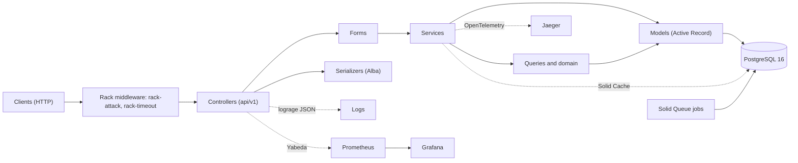
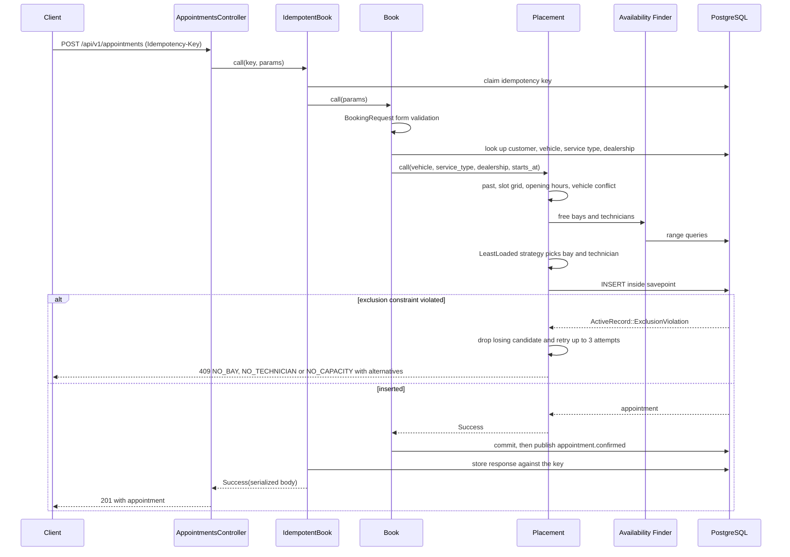
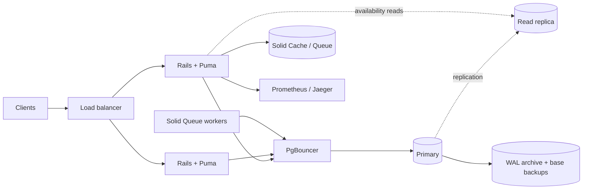

# System Design

## Contents
- [Scope](#scope)
- [Architecture](#architecture)
- [Booking data flow](#booking-data-flow)
- [Technology choices](#technology-choices)
- [Data model](#data-model)
- [Assumptions](#assumptions)
- [Assignment rule](#assignment-rule)
- [Concurrency](#concurrency)
- [Double-booking strategy and alternatives](#double-booking-strategy-and-alternatives)
- [Caching](#caching)
- [Targets](#targets)
- [Measurements](#measurements)
- [EXPLAIN findings at 1,000,000 rows](#explain-findings-at-1000000-rows)
- [Persistence and backup](#persistence-and-backup)
- [Appointment lifecycle and domain events](#appointment-lifecycle-and-domain-events)
- [Error catalogue](#error-catalogue)
- [Observability](#observability)
- [Scaling & Reliability](#scaling--reliability)
- [How GenAI assisted the design](#how-genai-assisted-the-design)
- [Limitations and future work](#limitations-and-future-work)

## Scope
Booking a service appointment needs a free service bay and a qualified, on-shift technician for the whole duration. This document records the architecture, the assignment rule, the concurrency model, caching, performance targets and the measurements taken at 1,000,000 appointments.

## Architecture


| Component | Role |
|---|---|
| Rack middleware | `rack-attack` throttles per IP (`429 RATE_LIMITED`); `rack-timeout` bounds request time (`504 REQUEST_TIMEOUT`). |
| Controllers | Thin: read params, call a form or service, render the envelope through the error catalogue. |
| Forms | `ActiveModel` request objects (`BookingRequest`, `RescheduleRequest`, `AvailabilityRequest`, `AppointmentListRequest`, `DealershipScheduleRequest`) validate every external input. |
| Services | One use case each (`Appointments::Book`, `IdempotentBook`, `Reschedule`, `Cancel`, `ChangeStatus`); return `Success`/`Failure`. |
| Queries | `Availability::Finder`, `FreeBays`, `FreeTechnicians`, `DaySlots`, `Alternatives` and `Appointments::ListQuery` encapsulate range SQL. |
| Domain | Pure Ruby in `app/domain/scheduling`: `TimeInterval`, `SlotTime`, `OpeningHoursPolicy`, `StatusMachine`, assignment strategies. No Active Record. |
| Models | Active Record aggregates and persistence; `Appointment` owns its transitions. |
| PostgreSQL | System of record; GiST exclusion constraints decide double-booking. |
| Solid Queue / Solid Cache | Database-backed jobs (idempotency-key cleanup) and cache (availability, rate-limit counters). |
| Observability | lograge JSON logs, Yabeda metrics scraped by Prometheus (Grafana is an optional dashboard, not shipped), optional OpenTelemetry traces to Jaeger. |

## Booking data flow

A failure rolls back the idempotency claim, so a retry with the same key runs again. A retry with the same key and body after a success replays the stored response; the same key with a different body returns `422 IDEMPOTENCY_KEY_REUSED`, and a key still being processed returns `409 IDEMPOTENCY_KEY_IN_PROGRESS`.

## Technology choices
| Area | Choice | Why |
|---|---|---|
| Language and runtime | Ruby 3.4 (CRuby, YJIT), Rails 8 API-only | Conventions, fast delivery, Solid stack built in. |
| Database | PostgreSQL 16 with `btree_gist`, `tstzrange`, UUID keys | Exclusion constraints give the double-booking guarantee at the database level; schema kept in `db/structure.sql`. |
| Business results | dry-monads `Success`/`Failure` | Expected outcomes are values, not exceptions. |
| Validation | Strong Parameters, `ActiveModel` forms, Active Record validations | Every external input is validated before use. |
| Serialization, pagination | Alba, Pagy | Light, explicit serializers and bounded lists. |
| Cache and jobs | Solid Cache, Solid Queue | Database-backed, no Redis. |
| Security | Brakeman, bundler-audit, rack-attack, rack-cors; no authentication in the MVP (A8) | Scan in CI; throttle abuse. |
| Observability | lograge, Yabeda with Prometheus, OpenTelemetry with Jaeger | Logs, metrics and traces tied by request id. |
| API docs | rswag generating `swagger/v1/openapi.yaml` | Request specs double as the OpenAPI source; CI fails on drift. |
| Testing | RSpec, FactoryBot, shoulda-matchers, SimpleCov, real PostgreSQL | No mocks for the exclusion constraints; coverage thresholds on domain and services. |
| Quality | RuboCop (omakase), Bullet, strong_migrations | Style, N+1 and migration safety. |
| Delivery | Docker, Docker Compose, GitHub Actions | Reproducible run and gated CI. |

## Data model
The full diagram is in [erd.md](erd.md). In short:
- A dealership has opening hours, holidays, service bays, technicians and the service types it offers.
- Technicians have qualifications, shifts and time off; bays can have maintenance blocks.
- A customer owns vehicles. An appointment links customer, vehicle, service type, dealership, one technician and one service bay, with a `tstzrange` `time_range` in UTC.
- `appointment_status_histories` and `appointment_reschedules` record every transition and move; `idempotency_keys` stores replayable booking responses.

## Assumptions
| # | Ambiguity | Assumption |
|---|---|---|
| A1 | Service duration | Fixed `duration_minutes` per ServiceType |
| A2 | "Qualified" technician | Technician holds a set of qualifications; ServiceType requires one |
| A3 | Technician/bay selection | System auto-assigns; the user does not choose |
| A4 | Bay differences | Bays have a type; ServiceType requires a bay type |
| A5 | Resources per appointment | Exactly one bay and one technician for the full duration |
| A6 | Time handling | Stored in UTC; dealership has an IANA time zone and opening hours; intervals are half-open `[start, end)` |
| A7 | Slot granularity | 15-minute grid (`SLOT_MINUTES`) |
| A8 | Auth / customer management | Out of scope; customer and vehicle are pre-seeded and referenced by ID |
| A9 | Vehicle ownership | A vehicle belongs to one customer; bookings are validated against it |
| A10 | Same-vehicle overlap | Not allowed |
| A11 | Payments, notifications | Out of scope (stretch) |

## Assignment rule
- Candidate bays are active bays of the dealership with the service type's `required_bay_type` and no overlapping active appointment or bay block.
- Candidate technicians are active, qualified when the service type requires a qualification, on a shift that covers the whole local interval, and free of time off and overlapping active appointments.
- `Scheduling::AssignmentStrategies::LeastLoaded` picks the technician with the fewest active appointments on the dealership-local day, ties broken by the lowest id, and the bay with the lowest id.

## Concurrency
- Bookings run at the PostgreSQL default `READ COMMITTED` isolation level. Two requests can both see a resource as free, so the availability read is advisory.
- Three partial GiST exclusion constraints on `confirmed` and `in_progress` appointments are the source of truth: `appointments_no_bay_overlap`, `appointments_no_technician_overlap` and `appointments_no_vehicle_overlap`.
- `Appointments::Book` runs each attempt in `transaction(requires_new: true)`. An `ActiveRecord::ExclusionViolation` removes the losing bay or technician from the candidates and retries; a vehicle violation returns `VEHICLE_ALREADY_BOOKED`.
- The retry bound is `MAX_ASSIGNMENT_ATTEMPTS = 3`. Each failed attempt removes one candidate, so when the candidates run out or the bound is reached the result is `NO_CAPACITY` (`409`).
- The 20-thread race spec books the last slot in parallel and expects exactly one success and 19 `409`s.

## Double-booking strategy and alternatives
| Option | Pros | Cons |
|---|---|---|
| **PostgreSQL exclusion constraint** (GiST on resource + `tstzrange`) | Strongest guarantee, enforced by the database, native migration support | PostgreSQL-specific |
| Pessimistic locks (`lock` / `with_lock`) on resource rows | Simple to reason about | Lower throughput, deadlock care |
| Optimistic locking (`lock_version`) / unique slot rows | Portable | More bookkeeping, does not protect new inserts |
| Distributed lock (Redis) | Cross-service | Extra infrastructure, weaker than a database guarantee |

Chosen: exclusion constraints as the final safety net, with the availability check and the insert in one transaction. The application check gives friendly errors; the constraint guarantees correctness when checks race. `lock_version` and `lock!` are used only on the lifecycle paths (cancel, reschedule, status change).

## Caching
`GET /api/v1/availability` caches the response body per dealership, service type and local date for 30 seconds. A booking does not invalidate it, so a listed slot may already be taken; `POST /api/v1/appointments` stays authoritative and returns alternatives on failure.

## Targets
| Operation | p95 target |
|---|---|
| Booking | under 100 ms at 1,000,000 appointments |
| Day availability | under 200 ms at 1,000,000 appointments |

## Measurements
Run on a scratch PostgreSQL 16 database on a developer laptop after `bin/rails "scheduler:load_data[1000000]"` (N = 1,000,000 appointments over 20 bays and 20 technicians, 180 appointments per day), then `ANALYZE`. Each figure is the p95 of 50 runs after 5 warm-up runs, in a single Rails process on a local database.

| Operation | p95 |
|---|---|
| `Availability::Finder#call` (one interval) | 1.08 ms |
| `Availability::DaySlots#call` (one fully booked day) | 7.08 ms |
| `Appointments::Book#call` (successful, rolled back) | 18.46 ms |

All three are inside their targets. These are in-process figures and exclude HTTP, serialization and network latency.

## EXPLAIN findings at 1,000,000 rows
- `FreeBays`: the `NOT IN` subquery on appointments uses an index scan on a GiST exclusion-constraint index (`appointments_no_vehicle_overlap`) with `time_range && tstzrange(...)`, about 0.11 ms. Bays are a 20-row sequential scan, which is cheaper than an index.
- `FreeTechnicians`: the same GiST index scan for the appointment subquery, about 0.22 ms; shifts, time off and technicians are tiny tables read sequentially.
- `DaySlots` appointment query: a bitmap scan on `index_appointments_on_technician_id_and_time_range` returns the 180 rows of the day in about 0.23 ms.
- No query reads `appointments` sequentially, so no index migration was added. `spec/queries/availability/query_plan_spec.rb` keeps this under test with `enable_seqscan = off` on the small test database.

## Persistence and backup
Appointments live in PostgreSQL on the named volume `pgdata`. `docker compose down` keeps the volume, so data survives; `docker compose down -v` deletes it. Restarting `web` or `db` never touches the volume.

Backup (custom-format dump of the compose database):
```
docker compose exec -T db pg_dump -U postgres -Fc scheduler_api_production > scheduler.dump
```

Restore into a running stack:
```
docker compose exec -T db pg_restore -U postgres -d scheduler_api_production --clean --if-exists < scheduler.dump
```

In production, use the managed database's automated backups and point-in-time recovery instead of dumps from the container.

`scripts/persistence_check.sh` needs only `docker compose` and `curl`. It starts the stack, books an appointment through the API, then checks that `GET /api/v1/appointments/{id}` returns 200 after creation, a `web` restart, a `db` restart and `docker compose down` followed by `up`. It prints one line per step and exits 1 naming the failed step. Run it manually; it is not part of `verify.sh` or CI.

## Appointment lifecycle and domain events
Status transitions live in the pure-Ruby `Scheduling::StatusMachine`; `Appointment#start!`, `#complete!`, `#mark_no_show!` and `#cancel!` delegate to it and raise `InvalidTransition` for a move the table doesn't allow.

| From | Allowed to |
|---|---|
| `confirmed` | `in_progress`, `cancelled`, `no_show` |
| `in_progress` | `completed` |
| `completed`, `cancelled`, `no_show` | none |

- `no_show` is accepted only at or after `start_at`, using the injected `Clock`.
- Every transition writes an `appointment_status_histories` row with `from_status`, `to_status`, `changed_at` and `actor`.

### Locking
Cancel, reschedule and status change start with `appointment.lock!` (`SELECT ... FOR UPDATE`), so concurrent lifecycle calls on one appointment serialize on the row and the final state matches one of the two orders. `lock_version` stays as optimistic locking; a reschedule request that sends a stale `lock_version` gets `409 CONCURRENT_MODIFICATION`.

### Reschedule
- The pipeline (past and slot-grid checks, opening hours, vehicle conflict, availability, assignment, savepoint retry) is shared with booking through `Appointments::Placement`.
- The appointment row is updated in place, so its id is kept and the exclusion constraints compare the new interval only against other rows.
- The availability queries and the vehicle conflict check take `exclude_appointment_id`, so a 15-minute shift is not blocked by the appointment's own old interval.
- The current bay and technician are kept when both are free at the new time; otherwise the assignment strategy picks.
- The previous and new intervals, actor and request id go to `appointment_reschedules`. A failed reschedule writes nothing.

### Cancel
Cancel sets `cancelled`, `cancelled_at` and `cancellation_reason` and writes the history row in one transaction. Cancelled appointments leave the `confirmed`/`in_progress` exclusion constraints, so the bay, technician and vehicle are free at once. A repeat cancel returns the current state without a new history row or event. `CANCELLATION_CUTOFF_HOURS` (default `0`, off) blocks cancelling closer to the start than the cut-off with `422 CANCELLATION_WINDOW_CLOSED`.

### Domain events
`Appointments::Events.publish` publishes through `ActiveSupport::Notifications` after the outermost transaction commits (`ActiveRecord.after_all_transactions_commit`), so a rollback, a failure or an idempotent repeat publishes nothing.

| Event | Extra payload |
|---|---|
| `appointment.confirmed` | none |
| `appointment.rescheduled` | `previous_start_at`, `previous_end_at`, `technician_id`, `service_bay_id` |
| `appointment.cancelled` | `cancelled_at`, `reason` |
| `appointment.status_changed` | `from_status`, `to_status` |

Every payload carries `appointment_id`, `customer_id`, `dealership_id`, `status`, `start_at`, `end_at`, `occurred_at` (UTC, from the injected clock) and `request_id` (`Current.request_id`, set per request from `X-Request-Id`).

`config/initializers/event_subscribers.rb` subscribes to `/\Aappointment\./` and writes one JSON line per event to `Rails.logger`.

### Outbox (production path)
In-process notifications are lost if the process dies between commit and publish. For at-least-once delivery, write an `outbox_events` row (event name, JSON payload, `published_at`) in the same transaction as the appointment change, then relay unpublished rows with a Solid Queue job that marks them published after delivery. Consumers dedupe on the event id. This is documented only; it is not implemented.

## Error catalogue
Every error response uses the envelope `{ success, data, error: { type, title, status, code, detail, errors? }, message }`. The full list with examples is in [error-catalogue.md](error-catalogue.md); the codes behind the booking flow are:

| Group | Codes | Status |
|---|---|---|
| Input | `VALIDATION_ERROR` (malformed or missing input) | 400 or 422 |
| Missing resources | `NOT_FOUND`, `APPOINTMENT_NOT_FOUND` | 404 |
| Time rules | `START_TIME_IN_PAST`, `START_TIME_NOT_ON_SLOT_GRID`, `OUTSIDE_OPENING_HOURS`, `DEALERSHIP_CLOSED`, `VEHICLE_OWNERSHIP_MISMATCH`, `CANCELLATION_WINDOW_CLOSED` | 422 |
| Capacity conflicts | `NO_BAY`, `NO_TECHNICIAN`, `NO_CAPACITY`, `VEHICLE_ALREADY_BOOKED` | 409 |
| Concurrency and idempotency | `CONCURRENT_MODIFICATION`, `INVALID_STATUS_TRANSITION`, `IDEMPOTENCY_KEY_IN_PROGRESS` (409); `IDEMPOTENCY_KEY_REUSED` (422) | 409 or 422 |
| Platform | `UNAUTHORIZED` (401), `RATE_LIMITED` (429), `INTERNAL_ERROR` (500), `SERVICE_UNAVAILABLE` (503), `REQUEST_TIMEOUT` (504) | various |

## Observability
- Logs: `config/initializers/lograge.rb` emits one JSON line per request in production (or with `LOGRAGE_ENABLED=true`) with `request_id`, `trace_id`, `appointment_id`, `method`, `path`, `status` and `duration`. Domain events add one JSON line each (see Domain events).
- Metrics: `config/initializers/yabeda.rb` defines `booking_attempts_total`, `booking_success_total`, `booking_failure_total` (tag `reason`, the error code), `booking_duration_seconds` and `availability_query_duration_seconds`, fed from the `booking.scheduler` and `availability.scheduler` notifications. They are exposed at `/metrics` when `METRICS_ENABLED=true`, guarded by `METRICS_TOKEN` when set.
- Traces: `config/initializers/opentelemetry.rb` starts the SDK when `OTEL_ENABLED=true` with Rack, Rails, PG and Active Record instrumentation, exporting to `OTEL_EXPORTER_OTLP_ENDPOINT`. Custom spans are `booking.transaction` and `booking.assignment` (tracer `scheduler.booking`), `availability.free_bays` and `availability.free_technicians`.
- Health: `GET /health` and `/health/live` for liveness, `GET /health/ready` for readiness, `GET /up` for the Rails check.

## Scaling & Reliability

### Topology


### Scaling
- Stateless instances: no session or local state, so any number of web instances sit behind the load balancer; readiness gates traffic.
- Puma and pool: `WEB_CONCURRENCY` processes times `RAILS_MAX_THREADS` threads, with pool size equal to threads per process. Total connections = instances x workers x threads and must stay under PostgreSQL `max_connections`.
- PgBouncer in transaction pooling mode multiplexes many app connections onto few server connections; prepared statements must be disabled or protocol-level pooling used.
- Read replicas: `connects_to` with a reading role serves availability queries. Replica lag means a slot may show free that was just taken. This is acceptable because the read is advisory; booking, rescheduling and cancellation always run on the primary, where the exclusion constraint decides.
- Partitioning: range partition `appointments` by `start_at` monthly once history is large; constraints must include the partition key.
- Solid Cache holds short-lived availability results in the database, so no extra infrastructure; stale entries only cause a failed booking, never a double booking.
- Rate limiting: Rack::Attack per-IP throttles (general and booking); the counter store must be shared (Solid Cache) across instances. Responses are 429 with `Retry-After`.
- Idempotency: `Idempotency-Key` with `IDEMPOTENCY_TTL` makes client retries after timeouts safe.
- Solid Queue scaling: add worker processes or threads per queue; jobs are database-backed, so workers scale independently of web.

### Why scale-out is safe
Double-booking is prevented by PostgreSQL exclusion constraints on bay and technician time ranges, not by application locks or in-process state. Any number of instances can race; the database rejects the loser and the service returns a `Failure`.

### Backup and recovery
Continuous WAL archiving plus daily base backups give point-in-time recovery. Targets: RPO of 5 minutes or less (WAL archive interval), RTO of 30 minutes (restore base backup, replay WAL, repoint `DATABASE_URL`). Restore is rehearsed quarterly.

### Quality attributes pass
- Reliability: exclusion constraints, idempotency keys, statement and request timeouts, graceful worker shutdown, backups with stated RPO/RTO.
- Scalability: stateless web tier, pooled connections, replicas for reads, partitioning path, queue workers scaled separately.
- Observability: JSON request logs with request and trace ids, Prometheus booking metrics, optional OTLP traces to Jaeger, liveness and readiness probes.
- Availability: multiple instances behind readiness-gated load balancing, rate limiting to shed abuse, replica and backup recovery paths.
- Maintainability: pure-Ruby domain, service objects returning `Success`/`Failure`, a single error catalogue, and docs kept next to the code.

## How GenAI assisted the design
Claude Code was used as a pair for the design, the implementation and the review. The design decisions below were mine; the assistant drafted, challenged and verified them.
- Design: it compared the double-booking options (table above) and drafted the layered structure, the error catalogue and the assignment rule; I chose exclusion constraints and the pure-Ruby domain.
- Implementation: epic-by-epic plans, then code and specs with a gate (`.claude/scripts/verify.sh`) after each change.
- Review: independent review passes produced findings that were fixed or declined with a reason.
- Verification: no AI claim was accepted without a spec, a query plan or a measured number; the cases where the output was wrong are in [ai-log.md](ai-log.md) and summarised in the README's AI Collaboration Narrative.

## Limitations and future work
Limitations:
- A single primary is the write ceiling; failover is manual or managed by the provider.
- Replica reads are eventually consistent.
- Rate limiting is per IP, so shared NATs are throttled together.
- Tracing via OpenTelemetry is optional and not enabled by default.
- Domain events are in-process: a crash between commit and publish loses them.
- No authentication or authorization (A8); payments and notifications are out of scope (A11).

Future work:
- Transactional outbox plus a message broker for domain events (see Outbox above).
- Partition `appointments` by `start_at` (monthly range partitions) once history grows; exclusion constraints must be re-expressed per partition.
- Invalidate or shorten the availability cache per dealership on booking if staleness becomes a problem.
- Read models for dashboards and reporting, fed from events.
- Kamal for multi-host deploys with rolling restarts and health-checked traffic switching.
